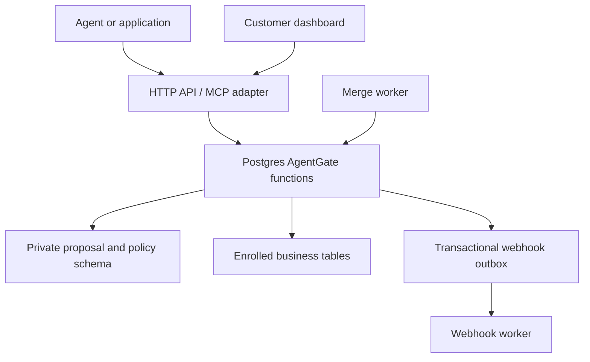

# AgentGate — Cursor Build Guide

**AgentGate — Postgres pull requests for AI agents.**

## 1. Product and agreed direction

Build an open-source, self-hostable API for proposing, reviewing, approving, and merging changes to Postgres data.

**Product promise:** Propose, review, and merge production data changes from your own application.

AI agents are the initial use case. Developers and conventional applications can use the same workflow. Companies retrieve PRs and structured diffs through the API and embed review in their existing dashboards. Include a small local demo dashboard as a reference client in the repository. Companies still embed production review in their own dashboards; a production dashboard remains outside scope.

Vinya is the company behind the project. The project is named **AgentGate**, with the tagline **Postgres pull requests for AI agents.** Use this name and tagline in the README, package descriptions, demo dashboard, and integration examples. Individual submissions are called data PRs. Supabase is an initial integration target; the core must work with standard Postgres and must not require a Supabase partnership to operate. Do not imply official partner status.

A Data PR changes records, rather than source code. It does not create a GitHub pull request or a database branch. Merge means applying the approved changes atomically to the existing database. A reverse PR proposes undoing a previously merged change.

## 2. Instructions for Cursor

Treat this document as the implementation specification. Start by inspecting the repository and following existing conventions. If it is empty, use the default stack below. Implement milestones in order, keeping each milestone runnable and tested. Report completed behavior, meaningful verification, and unresolved limitations after each milestone.

Build the project, not just scaffolding. Avoid unrelated features, a paid product, a hosted control plane, or a full production UI. Build the limited demo dashboard specified below. Never connect to or mutate production while developing. Use a disposable local Postgres database and synthetic data.

Resolve routine implementation details autonomously. Record material design choices in short architecture decision records. Do not silently weaken an invariant to make an endpoint work. Stop a milestone from being declared complete if its security or concurrency tests fail.

### Implementation stack

**Use C++ for the core backend.** This is the selected direction because the maintainer is more familiar with C++. Keep client-facing interfaces language-independent. Retain TypeScript for the demo UI, JavaScript SDK, and thin MCP adapter; Postgres remains responsible for transactional enforcement.

- C++20 for the HTTP API, application services, policy orchestration, merge worker, and webhook worker.
- CMake with presets and CTest for repeatable builds and test execution.
- Drogon as the proposed HTTP framework, unless an existing repository already uses a suitable C++ framework.
- `libpqxx` as the proposed Postgres client; versioned SQL migrations and PL/pgSQL for authoritative database operations.
- OpenAPI and JSON Schema as language-neutral request/response contracts. Choose a compatible maintained C++ validator and verify that validation actually runs before accepting requests.
- TypeScript on a supported Node.js LTS release for the demo UI and TypeScript client SDK.
- Official MCP TypeScript SDK for a thin adapter that calls the C++ HTTP API using the same authenticated identity and scopes.
- Docker Compose for the local database, C++ API/worker, and optional demo/MCP services.
- Catch2 or the repository's existing C++ test framework, plus real Postgres integration tests. Use a compatible TypeScript test runner for SDK/MCP/demo behavior.

C++ is selected; the specific framework and libraries are proposed defaults. Pin compatible versions through a checked-in dependency manifest and lock/baseline mechanism, using current official documentation. Prefer the repository's existing dependency manager; for a new repository use a vcpkg manifest with a pinned baseline. Do not silently revert the backend to TypeScript to simplify scaffolding.

Keep one repository with a shared C++ core library, separate API and worker executables, and separate TypeScript client packages. The demo backend proxy may use Node.js but must call the C++ API and contain no approval, policy, or merge implementation. A Postgres-backed queue is sufficient initially. Do not add Kafka, Redis, or microservices without a demonstrated need.

### C++ implementation requirements

Use RAII for database connections, transactions, locks, and other resources. Prefer explicit ownership, standard containers, and smart pointers; avoid manual owning allocation. Catch exceptions at process/request boundaries and convert errors to the documented response format without exposing secrets.

Use a bounded database connection pool. A connection and its transaction must be exclusively owned by one operation at a time. If using synchronous libpqxx calls, execute them on a bounded blocking-work pool instead of blocking HTTP event-loop threads. Set request, statement, lock, and queue timeouts; handle graceful shutdown without dropping committed receipts.

Use established libraries for cryptography, credential hashing, and webhook signatures. Do not write custom crypto. JSON numbers must not lose precision while crossing the C++/TypeScript boundary; follow the typed representations in the API contract.

Provide documented `cmake --preset` build/test commands, formatting configuration, compiler warnings, and CI builds for supported compilers. Run AddressSanitizer and UndefinedBehaviorSanitizer in a compatible CI job and exercise concurrency with meaningful tests. Keep Docker installation available so users do not need a local C++ toolchain.

Measure proposal latency, merge latency, connection utilization, queue delay, lock waits, and throughput with representative PR sizes. Optimize measured bottlenecks; do not weaken transaction guarantees or implement an in-memory replacement for authoritative database state.
## 3. MVP scope and delivery stages

### Read and write functionality

AgentGate supports authorized reads and governed writes. Governed writes are the core product; reads let agents gather permitted data and capture dependencies before proposing a change.

| Operation | Initial behavior |
| --- | --- |
| Read | Authenticate the principal, enforce enrolled table/column/row/tenant scope, return explicitly addressed rows, and optionally return a tracked-read token; permitted reads do not create PRs |
| Update | Create a PR with an exact diff; evaluate policy, collect approval when needed, check drift, and merge atomically |
| Insert / Delete | Intended to use the same governed workflow, but explicitly unsupported until later milestones implement them |
| Arbitrary SQL / DDL | Unsupported in the initial release |

Use `read_rows` through MCP or `POST /v1/reads` through HTTP. Return the required row revision for update proposals; issue dependency tokens when tracked reads are requested. The demo should use tracked reads. Reads through other database connections cannot be tracked by AgentGate. Initial reads address explicit primary keys; range queries, aggregates, absence checks, and unrestricted SQL are not supported.

Read authorization and write authorization are distinct: permission to view a row does not grant permission to propose or merge changes to it. Read access is checked before returning data, not after reviewer approval. Do not claim AgentGate secures paths through which agents retain separate database credentials.

### First runnable slice

Structured updates to existing rows, identified by explicit primary keys. Propose, retrieve diff, approve, merge, detect stale data, and retrieve audit history. Manual approval first. Add the basic demo dashboard once this API flow works, so developers can see submissions and try review locally.

### Complete initial release

Add deterministic automatic approval policies, tracked reads, reverse PRs for updates, webhooks, MCP tools, a TypeScript SDK, a tested Supabase setup guide, and the complete local demo walkthrough.

### Later work

Inserts and deletes, composite primary keys, supported trigger adapters, richer dependency tracking, batch reversal of the last N PRs, and optional branching integrations. Preserve extensible operation types but return an explicit unsupported-operation error until implemented.

### Exclusions

- Arbitrary SQL execution, DDL, stored procedure execution, and SQL expressions supplied as values.
- Writes addressed by arbitrary filters or joins. The initial proposal contains explicit row IDs.
- Tables without supported primary keys, views, partitioned/inherited tables, and foreign tables.
- Tables with user-defined triggers or rules until their effects are explicitly supported. The project's own revision trigger is allowed.
- Primary-key changes, generated-column writes, and unsupported types.
- Guaranteed undo of external effects such as payments, emails, or downstream automation.
- Detection of every query or aggregate an agent relied on.
- Enterprise SSO, managed hosting, billing, and a production review dashboard.

Start with ordinary tables using one UUID or integer primary key. Support an explicitly documented scalar type subset. Handle big integers and numeric values without JavaScript precision loss; use typed string representations where necessary. Define null, missing fields, timestamps, and JSON values consistently. Unsupported schemas must fail enrollment, rather than produce unreliable diffs.

## 4. Architecture



Install the private `agentgate` schema in the same database as the business tables. This allows business changes, execution receipts, audit events, and webhook outbox events to commit together.

The HTTP API authenticates callers and translates validated requests into narrowly scoped database function calls. The TypeScript MCP adapter calls the C++ HTTP API; it must not implement a second execution path or connect directly to the database. Preserve per-principal authentication and scopes rather than forwarding requests through one privileged shared identity. The worker processes approved merge requests through the same database engine.

Use SQL migrations and PL/pgSQL functions initially. No compiled Postgres extension is required. Store all authoritative proposals, decisions, and merge receipts in Postgres. Avoid a second database containing a conflicting copy of PR state.

Use `agentgate` consistently as the private schema name: for example, `agentgate.prs`, `agentgate.approvals`, `agentgate.policies`, and `agentgate.audit_events`. “Data PR” remains a descriptive term for submissions, not the schema name.

For a new installation, create the schema directly as `agentgate`. If a prior `data_pr` schema is already installed, add a versioned rename migration rather than dropping and recreating it. Preserve its records and review all qualified function references, dynamic SQL, search paths, grants, tests, and API exposure settings. Fail visibly if both old and new schemas exist; do not merge them silently.

## 5. Trust and permission model

### Application principals

| Principal | Allowed actions |
| --- | --- |
| Proposer / agent | Read permitted data, open PRs, view authorized PRs, request an allowed merge |
| Reviewer | View permitted diffs, approve or reject for designated scopes |
| Policy administrator | Enroll tables and manage policy and reviewer assignments |
| Execution worker | Execute approved PRs through the guarded merge function |

An agent cannot approve its own PR. Human approval may require one designated reviewer initially. Approval assignments come from administrator-managed configuration, not request bodies. Policy-based automatic approval records a system decision separately from human approval.

For the initial self-hosted deployment, use high-entropy bearer credentials mapped to server-side principals and scopes. Store credential hashes, support revocation, and never put credentials in a browser. Customer dashboards call through their backend, which authenticates their users. A backend reviewer credential represents that backend unless a verified user identity adapter is configured; do not pretend a free-form `reviewer_id` proves individual identity.

### Database roles

- Migration owner: used only for installation and enrollment, never as runtime credentials.
- API runtime: execute only approved read/proposal/review functions; no direct business-table writes or metadata-table writes.
- Worker runtime: execute only guarded merge and queue functions; no unrestricted business-table writes.
- Function owner: a narrowly privileged `NOLOGIN` role, without superuser or `BYPASSRLS`, owning hardened functions.

Security-definer functions must have a safe fixed `search_path`, qualify object names, validate enrolled objects, quote identifiers, bind values, and revoke default `PUBLIC` execution privileges. Do not accept arbitrary SQL strings. Do not rely on a regex to make SQL safe.

The authenticated API is a trusted identity boundary. Agent input cannot set effective principal, scopes, tenant, or execution role. Internal identity arguments to database functions are populated only from verified server context. Database runtime credentials must never be exposed to agents. Protect approval functions from execution-worker credentials.

Existing application writers may continue writing normally. Agents must lose every alternative write credential, including permissive Supabase RPCs and service-role keys. Otherwise this workflow is optional and bypassable. Database owners remain trusted administrators; do not claim protection against a database administrator.

For multi-tenant business tables, require an enrolled tenant column and an enforced principal-to-tenant scope. Revalidate it on reads, proposals, reviews, and merge. RLS can provide additional enforcement but must be explicitly tested for the chosen runtime/function roles. Tenant-isolation claims must wait until these tests pass.

## 6. Data model

Use UUID IDs, `timestamptz` timestamps, foreign keys, unique constraints, and indexes on queue and list predicates. All tables below live in the private schema and are inaccessible through normal customer-facing Data APIs.

| Table | Required contents |
| --- | --- |
| `principals` / `credentials` | Identity, kind, scopes, credential digest, revocation |
| `table_registry` | Stable table identity, schema/name, primary key, allowed columns/types, tenant mapping, schema fingerprint |
| `policies` | Immutable policy versions, operation/table/column rules, approval requirements, limits |
| `reviewer_assignments` | Principal or verified group assignments by scope |
| `prs` | Title, reason, task reference, proposer, state, active revision, expiration, optional source PR |
| `pr_revisions` | Immutable canonical changeset, content hash, policy version/decision, creation time |
| `pr_changes` | Ordered row IDs, expected revision, before values, proposed after values |
| `read_snapshots` | Opaque token digest, principal, scope, expiry, stored row dependencies |
| `approvals` | Principal, exact revision/hash, decision, time |
| `merge_jobs` | PR/revision, enqueue time, attempt/lease metadata |
| `merge_receipts` | Unique PR/revision, committed changes, execution identity, commit time |
| `audit_events` | Append-only application history: proposal, decisions, conflicts, execution |
| `outbox_events` / `webhook_deliveries` | Stable event IDs, destinations, attempts, next retry, results |
| `idempotency_keys` | Principal, route, key, request digest, durable response reference |

Do not store hidden chain-of-thought. Store agent-supplied reason, task ID, and optional safe context references. Conversation transcripts are excluded by default. Before/after data can be sensitive; enforce diff authorization and avoid logging it.

### Row revision tracking

Enrollment adds a reserved bigint revision column and a project-owned `BEFORE UPDATE` trigger. Initialize existing rows at revision 1. Every update, including ordinary application writes, increments the revision. Disallow proposals from changing the revision column.

Revisions catch an update followed by a change back to the old value. Do not use timestamps alone. Document the required schema change and impact on applications using `SELECT *`. This is an explicit installation action, not an automatic side effect of proposing a PR.

Deleting and recreating the same key can reset a row-local revision. Capture and compare the enrolled before-image as well; document that this does not prove historical continuity. Generation-aware identity tracking is later work if delete/recreate detection becomes a requirement.

## 7. Proposal contract and immutable approval

Example request:

```json
{
  "title": "Correct invoice payment terms",
  "reason": "Invoice terms differ from the signed purchase order.",
  "task_id": "task_123",
  "expires_in_seconds": 3600,
  "read_tokens": ["opaque_server_issued_token"],
  "changes": [
    {
      "operation": "update",
      "schema": "public",
      "table": "invoices",
      "key": {"id": "482"},
      "expected_revision": "12",
      "set": {"payment_terms": "net_30"}
    }
  ]
}
```

The server resolves and authorizes the table, reads the current row, checks the expected revision, normalizes typed values, and computes the diff. Never trust a client-supplied before-image or row count. Reject duplicate targets and no-op changes. Enforce configurable payload, row, and expiry limits.

Store the immutable revision and return `pr_id`, revision, content hash, state, structured diff, and policy decision. Canonicalize the proposal once using a specified deterministic serialization. Include target identities, types, before/after values, dependencies, schema fingerprint, scope, and expiry in the approved content.

The human approval request must carry both revision and hash. Approval applies only to that stored revision. A revision endpoint creates a new immutable revision and invalidates previous approvals and queued merge eligibility. Serialize revision changes against merge using the PR row lock.

## 8. HTTP API

Prefix routes with `/v1`. Publish OpenAPI schemas, examples, and stable error codes.

| Method and route | Behavior |
| --- | --- |
| `POST /reads` | Read explicit allowed rows; return typed data and opaque dependency token |
| `POST /prs` | Create immutable initial proposal and evaluate policy |
| `GET /prs` | Cursor pagination; authorized filters for status, table, proposer, time |
| `GET /prs/:id` | Metadata, revision/hash, policy outcome, approvals, execution status |
| `GET /prs/:id/diff` | Authorized structured before/after values, types, row revisions |
| `POST /prs/:id/revisions` | Create revised proposal; invalidate approvals |
| `POST /prs/:id/approve` | Approve exact revision/hash as verified reviewer |
| `POST /prs/:id/reject` | Reject exact revision/hash with a reason |
| `POST /prs/:id/merge` | Enqueue authorized approved revision; return job/status reference |
| `POST /prs/:id/revert` | Build a new reverse PR from the committed receipt |
| `GET /prs/:id/events` | Authorized audit history |
| `POST /webhooks` | Administrator registers approved destination and event subscriptions |

Require `Idempotency-Key` on proposal, revision, review, merge, and revert mutations. Same key and request returns the durable result; same key and different request returns a conflict. Scope keys by principal and route. Database uniqueness protects concurrent retries.

Suggested errors: `UNAUTHORIZED`, `FORBIDDEN`, `UNSUPPORTED_TABLE`, `UNSUPPORTED_OPERATION`, `POLICY_BLOCKED`, `REVISION_MISMATCH`, `PR_EXPIRED`, `DRIFT_CONFLICT`, `SCHEMA_CHANGED`, `IDEMPOTENCY_CONFLICT`, `LIMIT_EXCEEDED`, `CONSTRAINT_VIOLATION`. Use 401/403, 404, 409, 422, and 429 consistently. Never expose unauthorized row values in errors.

### State transitions

`pending_review` → `approved` → `queued` → `merged`.

Other outcomes: `blocked`, `rejected`, `expired`, `conflicted`, `failed`. Automatic approval may create a PR directly in `approved`. A lease is worker metadata, not evidence that a change committed. Only the transactional receipt proves merge.

Revision, rejection, approval, queueing, and execution must use guarded transitions. Conflicted or expired revisions cannot merge; create a fresh revision and repeat review. Transient worker failures may retry the same approved revision until expiry; terminal schema/permission/constraint failures must be visible and require resolution.

## 9. Policy engine

Use administrator-authored declarative rules, never an LLM approval decision or arbitrary executable policy code. Validate policies and store immutable versions.

- Block prohibited tables, columns, operations, and unsupported features.
- Require designated human approval for sensitive tables/columns.
- Auto-approve an allowlisted low-risk update only when actual affected row count and all other conditions pass.
- Default to human approval when no auto-approval rule applies; absence of table enrollment is a block.
- Block rules dominate human and automatic approvals. Human-required rules dominate auto-approval rules.
- Evaluate mixed-table PRs as one atomic proposal using the strictest requirements.

Initial example: auto-approve fewer than 10 rows in approved `customer_profiles` columns; require finance review for `payments`; block DDL and deletes because those operations are unsupported initially.

Add per-principal rolling row/request limits shared across concurrent workers, using locked counter records. Check and reserve limits transactionally at merge. A small per-PR row limit alone does not prevent splitting a large operation into many small PRs.

Revalidate current authorization and policy before merge. If the applicable policy version changed, conservatively require a new revision/decision; do not execute using a revoked rule or reviewer assignment.

## 10. Atomic merge algorithm

The guarded database merge function receives a stored PR/revision reference, not a fresh changeset from the worker.

1. Lock the PR row. Return the existing receipt if this revision already merged.
2. Validate the active revision, approval/hash, expiry, current policy, principal scope, and reviewer eligibility.
3. Lock policy/configuration records needed to make those checks stable during this transaction.
4. Acquire target and dependency row locks in a deterministic global order. Use bounded lock and statement timeouts.
5. Revalidate enrolled schema fingerprints and supported table features while holding the appropriate relation locks. Coordinate application schema migrations; incompatible changes fail closed.
6. Compare revisions and captured before-images. Check required dependency rows. Any mismatch aborts the entire business changeset.
7. Reserve rate limits; apply only the stored typed field changes. Recheck tenant scope.
8. Verify exact affected counts and actual after-values; no silently skipped rows. Capture resulting row revisions.
9. Write the unique execution receipt, audit event, merged state, and webhook outbox event in the same transaction.
10. Commit and then acknowledge the job.

Use null-safe equality and parameterized values. Do not rerun broad predicates from an original proposal. Do not hold transactions or locks while waiting for a human.

If a failure rolls back the transaction, record its non-sensitive outcome in a separate guarded transaction, checking that no concurrent merge already succeeded. A crash after commit is resolved by retrieving the existing receipt. Never rely on in-memory job status for idempotency.

The initial exact-preview guarantee applies only to supported direct row updates. User-defined triggers/rules and cascading side effects are excluded; do not market arbitrary-SQL safety.

## 11. Drift and tracked reads

`POST /reads` accepts explicit table keys and allowed columns. The service stores row revisions and before-images and returns a principal-bound, expiring opaque token. Proposal creation rejects a token from another principal/scope or an expired token, and freezes its dependencies into the proposal revision.

Merge locks and checks dependency rows even if they are not written. This catches an agent using stale inputs. Missing dependency rows conflict.

Initial guarantees are limited to explicit existing-row dependencies. Reads of aggregates, ranges, or absence conditions are unsupported for automatic dependency tracking. An external read cannot be retrospectively tracked. Do not claim serializable execution validates reads that happened earlier in a different transaction.

## 12. Revert semantics

For update PRs, generate a new proposal restoring changed business fields from the committed before-image. Expect the row revision captured after the original merge and compare its actual after-image. Any intervening update conflicts, conservatively, even if it touched unrelated fields.

The reverse proposal goes through normal policy, approval, drift checking, and execution. Increment revisions normally; never restore old revision counters. Preserve `source_pr_id` and the original receipt. Do not delete audit history.

Do not implement an unconditional reset or promise one-click undo of external effects. Batch reversal requires reverse chronological ordering and dependency planning; defer it until single-PR reversal is reliable.

## 13. Webhooks and integrations

Events: `pr.created`, `pr.approved`, `pr.rejected`, `pr.conflicted`, `pr.expired`, `pr.merged`, and `pr.failed`.

Use the transactional outbox. Deliver at least once with stable event IDs, HMAC signatures over the exact body plus timestamp, bounded retries with backoff, and delivery history. Consumers deduplicate. Keep row values out of webhook payloads by default; authorized consumers fetch the diff.

Only administrators configure destinations. Validate URLs, disable redirects, enforce network destination policy at delivery, and block metadata/loopback/private destinations by default. Allow explicitly configured internal destinations for self-hosted deployments. Never expose webhook secrets in list responses.

MCP tools: `read_rows`, `propose_change`, `get_pr`, `get_pr_diff`, `list_prs`, and `get_pr_status`. Do not expose human approval or policy administration through the agent-facing MCP server. Optional merge requests must pass the same authorization as HTTP. Explain pending/conflicted results clearly so agents do not assume a proposal already wrote data.

## 14. Supabase integration

Provide SQL installation instructions, scoped database-role configuration, and a tested connection configuration for the selected direct/pooler mode. Avoid session-state assumptions across pooled transactions; verify driver settings against current Supabase docs.

Keep `agentgate` private and outside exposed API schemas. Never use a service-role key in agent code. Verify all alternative write paths and RLS behavior in an integration checklist.

Use a separate verified Supabase Auth adapter for reviewer identities when implemented. Validate token signature, issuer, audience, and expiry; map the verified subject to project-managed reviewer assignments. A publishable project key alone is not reviewer authentication.

The initial demo should contain a synthetic invoice table and API calls demonstrating read → proposal → approval → merge → reverse proposal. Show how a customer's existing backend fetches a diff and approves a PR. No hosted dashboard or official Supabase partnership is required.

## 15. Local demo dashboard and clone-to-demo experience

Include `examples/demo-dashboard` as an optional reference client, enabled in the default local demo quickstart. Its purpose is to let developers see agent submissions and exercise the workflow immediately after cloning. Keep the core API independently deployable.

### Four simultaneous panels

Show all four panels on one desktop screen, preferably as a responsive 2×2 grid. Keep their latest states visible throughout the walkthrough and highlight the active panel. On smaller screens, stack the panels without removing their state.

| Panel | Contents |
| --- | --- |
| Agent intent | Task, proposed field changes, supplied reason, real MCP tool request and response, and scripted-agent status |
| AgentGate | Actual authentication/validation outcomes when available, policy decision, PR ID/revision, pending/approved/queued/merged/conflicted status, and execution receipt |
| Company dashboard | An embedded example company review client: submission list, selected PR diff, reviewer identity, and approval/rejection controls |
| Business data in Postgres | Actual synthetic business record values and row revision, fetched from the local database through a scoped demo backend read |

Call the fourth panel **Business data in Postgres**. AgentGate proposal and audit metadata are already stored in Postgres before merge; avoid saying the entire database remains unchanged. Business row values remain unchanged by the proposal until merge.

Use a small TypeScript UI and the real API. The company dashboard panel is an example API client, not AgentGate's authoritative state. Do not copy policy or merge logic into the browser. Keep submission/detail/activity information within these panels rather than making separate screens the main demo.

### Step-by-step controls and real MCP requests

The walkthrough uses explicit user clicks. Disable advancing while an operation is in flight, display errors, and use idempotency keys so retries and double clicks cannot duplicate mutations.

| Click | Real operation | Result shown |
| --- | --- | --- |
| Prepare sample agent | Scripted actor reads an eligible synthetic invoice through MCP `read_rows`, capturing its revision and tracked-read token | Agent intent and original business values appear; no PR exists yet |
| Send request | Scripted actor calls MCP `propose_change`; the MCP adapter calls the C++ API | AgentGate validates, evaluates policy, and persists a pending PR; business values stay unchanged |
| Show submission | Example company client fetches PR metadata and diff through the HTTP API | Company dashboard panel displays the submission, reason, exact revision/hash, and diff |
| Approve | Separate demo finance reviewer approves the displayed revision/hash through the API | AgentGate becomes approved; business values stay unchanged |
| Merge | Company client requests merge; the worker uses the guarded database function | Display queued status, then the receipt-backed result and newly fetched business values after commit |

The primary sample uses a manual-review policy so it does not auto-approve before the approval step. Approval and merge are separate controls. The company dashboard does not write the business table directly.

Provide a clearly labeled **Run sample agent** entry point that starts this scripted walkthrough. No LLM, paid service, or external API key is required. Use a real MCP client/server invocation, not a direct HTTP call labeled MCP. Agent requests use only the proposer credential; review uses a separate reviewer credential.

Validation and PR creation complete within the proposal request. If animating those internal stages for explanation, use actual events/outcomes and identify replayed stages as such. Do not fabricate security-check events or add artificial production lifecycle states. Never keep a database transaction, row lock, or live request open waiting for the next user click.

Step mode controls when the example company client fetches and displays its review submission. It must not pretend that a persisted PR was unavailable before that click. Keep the AgentGate panel's real status distinct from the dashboard's last fetched state. During queued merge, poll until a terminal result; never present queue acceptance as a committed write.

Render agent intent as a task and supplied explanation, not hidden chain-of-thought. Hide credentials from all request displays. Refresh business data from Postgres after actions instead of calculating new database values only in browser memory.

### Drift and reverse-PR walkthroughs

Between approval and merge, offer **Simulate another application changing this record**. A demo-only ordinary-writer helper changes the selected local fixture and increments its revision. Refresh the business panel to show that change. On Merge, show the real `DRIFT_CONFLICT`, display which authorized dependency changed, and confirm that AgentGate did not overwrite the other application's values.

After reverse-PR support is implemented, add **Propose revert** for a clean merged example. Show the reverse PR and its diff in the same four panels, then approve and merge it through the normal workflow. Do not call this an unconditional reset.

Use another eligible fixture for repeat runs or explain a no-op. Preserve PR IDs, revisions, event history, and receipts between steps. The conflict simulator must be confined to preselected local fixtures; do not add an unrestricted write endpoint to the core API.

### Local setup and isolation

Document a quickstart command such as `docker compose -f compose.demo.yml up --build`. Provide health checks, idempotent migration/seed initialization, and an explicit dashboard URL. Bind exposed demo ports to loopback by default.

Use a disposable demo database. Generate local proposer and reviewer credentials on setup and keep them in the demo backend environment. The browser calls that backend; it never receives bearer secrets, database passwords, or administrator credentials. Display which fixed demo actor performs an action so the sample does not imply real human identity verification.

Disable the sample-agent and fixture-mutation helpers outside explicit demo mode. Demo mode must use the bundled local database, not arbitrary database connection settings. Reject conflicting production/remote connection configuration. Isolate demo service credentials from the core production deployment.

Provide a documented reset command that clears only the named demo environment after explicit invocation. Preserve the ordinary quickstart's data across restarts. Make reset scope obvious and never automatically reset on startup.

### Verification

Exercise one happy-path demo and one stale-data conflict against real Postgres, the actual API, and a real MCP invocation. Verify that all four panels remain visible, the dashboard display can be advanced independently of PR persistence, approval does not modify business values, queue acceptance is distinct from commit, and the business panel reflects actual database reads. Verify no secret appears in frontend assets or responses, the proposer cannot approve, and fixture helpers are unavailable outside demo mode. The UI is a reference integration; no alternate approval or merge implementation is permitted.

## 16. Repository organization

| Path | Contents |
| --- | --- |
| `apps/api` | C++ HTTP routes and authentication; links the shared core library |
| `apps/worker` | C++ merge jobs and webhook delivery; links the shared core library |
| `core` | Shared C++ application services, policy orchestration, database client, and error mapping |
| `cmake` | Build configuration, presets support, and dependency integration |
| `packages/db` | Migrations, permissions, guarded functions |
| `packages/contracts` | Language-neutral JSON Schema and OpenAPI; contract tests for C++ and TypeScript |
| `packages/sdk` | TypeScript client |
| `packages/mcp` | Thin TypeScript MCP adapter calling the C++ API |
| `tests/integration` | C++/API tests against real Postgres: concurrency, privileges, and webhooks |
| `examples/supabase` | Synthetic data and integration walkthrough |
| `examples/demo-dashboard` | Local reference UI, backend proxy, scripted sample agent, demo fixtures |
| `docs/architecture` | Short decision records and permission model |

Include README, quickstart, CONTRIBUTING, SECURITY, supported-schema documentation, and an `.env.example` with placeholders. Recommend Apache-2.0 as a license candidate; leave final licensing to the project owner rather than silently applying it. Do not inherit unrelated project branding.

### GitHub ownership and founder visibility

Host the public `agentgate` repository under an AgentGate-branded GitHub organization, with Kirthi Narayanan visibly identified as the creator and maintainer. Use a regular organization on GitHub Free initially; GitHub Enterprise is not required for this project setup.

The organization handle is not yet confirmed. Use `<agentgate-org>` and `<kirthi-github-username>` as explicit placeholders until the owner supplies verified handles. Do not invent accounts, claim handle availability, or create an organization as part of implementing this guide.

| Area | Required setup |
| --- | --- |
| Repository | `<agentgate-org>/agentgate`; public open-source project after the owner chooses its license and publishes it |
| README | Display the AgentGate name/tagline and “Created and maintained by Kirthi Narayanan,” linking to the verified personal GitHub profile |
| Project backing | Identify Vinya as the company behind the project while retaining AgentGate as the project brand |
| Maintainer documentation | List current maintainers and explain contribution/review responsibilities; initially identify Kirthi without implying an existing team |
| Organization profile | Describe AgentGate and link to its main repository and documentation |
| Personal profile | Feature AgentGate and identify Kirthi as its creator |
| Launch and outreach | Use founder-led engineering posts, demos, and explanations linked to the organization-owned repository |

The intent is project-owned repository, founder-led visibility. Do not portray an organization account as proof of enterprise readiness, multiple maintainers, or official partnership status.

Continue committing through personal contributor accounts with correctly configured author attribution. Use organization roles to add maintainers as the project grows. GitHub repository ownership is an administrative arrangement; it does not itself determine copyright ownership or contributor licensing.

In the README and release documentation, use the canonical organization repository URL once verified. Keep onboarding instructions, issue links, clone commands, and package repository metadata consistent. Preserve the selected C++ backend, API-first design, and local demo quickstart.

Cursor should add the creator credit, maintainer documentation, and repository placeholders while building the project. Creating GitHub accounts/organizations, transferring repositories, editing personal profiles, publishing code, and posting outreach are separate actions and are not requested by this build guide.

## 17. Milestones and acceptance criteria

### Milestone 1 — Local database foundation

CMake foundation, pinned dependencies, shared C++ core and API/worker targets, Compose setup, migrations, enrollment, revision tracking, role grants, synthetic invoice data. Document Docker and native build commands. Verify runtime roles cannot directly update enrolled rows or metadata and cannot execute privileged functions they do not need.

### Milestone 2 — Proposal and manual review API

C++ API authentication and schema validation, typed updates, server-computed diffs, immutable revisions/hash, reviewer assignment, expiration, idempotency, listing. Verify OpenAPI examples against the C++ implementation. Verify self-approval, spoofed reviewer identity, unauthorized diff access, and approval of old revisions fail.

### Milestone 3 — Atomic merge and queue

Guarded merge function, deterministic locking, receipts, durable queue. Add the four-panel demo with agent intent, AgentGate status, company review state, and real business data; separate approval and merge actions. Use real API calls initially; the completed walkthrough must invoke the MCP adapter once it is delivered. Verify two concurrent workers produce one receipt; loss of response after commit does not double-apply; one stale row rolls back the entire PR; incompatible schema changes prevent merge.

### Milestone 4 — Policy and tracked reads

Declarative policy precedence, automatic approval, transactional limits, read tokens and dependencies. Verify a dependency-only row update conflicts, policy revocation prevents merge, and concurrent small PRs cannot bypass aggregate limits.

### Milestone 5 — Reverse PRs and webhooks

Receipt-based reverse proposals, drift checks, outbox delivery/signatures/retries. Verify revert succeeds only against the expected current state, subsequent edits are protected, failed merges emit no merged event, and consumers can deduplicate deliveries.

### Milestone 6 — Developer integration

OpenAPI, SDK, MCP, local quickstart including the demo dashboard, Supabase example, permission documentation, creator attribution, and organization repository metadata. Complete the real MCP sample-agent flow, user-controlled four-panel walkthrough, drift-conflict and reverse-PR walkthroughs, and local reset tooling. Verify HTTP and MCP produce equivalent proposals; agents cannot approve; every documented example runs from a clean checkout with synthetic data. Verify the demo's buttons use real API operations, credentials remain server-side, the sample agent cannot approve, and a stale approved proposal displays the actual drift conflict.

### Required regression cases

Test null changes, numeric precision, injection attempts in identifiers/values, duplicate targets, no-op updates, revoked credentials, tenant boundary violations, expired approvals, row disappearance, trigger/rule enrollment rejection, post-enrollment unsupported schema changes, lock contention/deadlocks, and webhook URL restrictions.

The release is ready when a developer can clone the repository, start the local demo, run a sample agent without an LLM key, view its submission and diff, approve and merge an exact revision, observe an auditable receipt, reproduce a drift conflict, and open a conflict-aware reverse PR. The same flow must remain accessible through the documented API for the developer's own application.

## 18. Starting prompt for Cursor

> Read `agentgate_cursor_build_guide.md` and treat it as the build specification. Inspect the repository, record a short milestone plan, and implement Milestone 1 followed by Milestone 2. Use a disposable local Postgres database. Use C++20 for the API and workers, SQL/PLpgSQL for database enforcement, and TypeScript only for the client SDK, demo UI/proxy, and thin MCP adapter. Follow the MVP scope: API-first, structured updates, a four-panel local demo using real MCP and API calls with separate approval and merge, the private schema named `agentgate`, no production dashboard, no arbitrary SQL, and no production credentials. Verify database privilege boundaries and immutable approval behavior with real integration tests. Report completed behavior and blockers, then continue through the remaining milestones in order.

## 19. Primary references

Consult current official documentation during implementation, particularly for C++ build dependencies, security-definer functions, concurrency, connection pooling, authentication, and MCP transports:

- [Drogon official repository](https://github.com/drogonframework/drogon)
- [libpqxx official documentation](https://libpqxx.readthedocs.io/stable/)
- [CMake documentation](https://cmake.org/cmake/help/latest/)
- [vcpkg manifest documentation](https://learn.microsoft.com/en-us/vcpkg/concepts/manifest-mode)

- [Postgres CREATE FUNCTION and security-definer guidance](https://www.postgresql.org/docs/current/sql-createfunction.html)
- [Postgres explicit locking](https://www.postgresql.org/docs/current/explicit-locking.html)
- [Postgres transaction isolation](https://www.postgresql.org/docs/current/transaction-iso.html)
- [Postgres row security](https://www.postgresql.org/docs/current/ddl-rowsecurity.html)
- [Supabase Postgres roles](https://supabase.com/docs/guides/database/postgres/roles)
- [Supabase database connections](https://supabase.com/docs/guides/database/connecting-to-postgres)
- [Model Context Protocol documentation](https://modelcontextprotocol.io/docs/getting-started/intro)

This document describes a proposed implementation. It does not claim that the software has been built, security audited, or accepted into a technology partner program.
