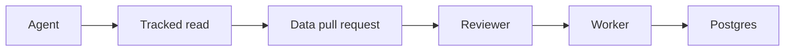

# AgentGate

<video src="media/AgentGate_Simulation.mp4" width="100%" controls playsinline></video>

AgentGate is an open-source, self-hostable API for proposing, reviewing, approving, and merging changes to Postgres data. It is built for apps where an AI agent needs to change a record, and a human approves the exact change before it is written: support tools, ops copilots, and internal agents. A data pull request changes rows in the existing database. It does not open a GitHub pull request and it does not create a database branch. Merge applies the approved change atomically.

AgentGate works with standard Postgres. It also works with Supabase as a Postgres host: install the private `agentgate` schema, use scoped database roles, and keep that schema out of exposed Data API schemas. No Supabase partnership is required to run it, and this project does not claim partner status.

Created and maintained by [Kirthi Narayanan](https://github.com/KirthiNarayanan).


## Simulation: AgentGate in Action

The [simulation](https://agentgate-database.github.io/AgentGate/) plays four panels. An agent asks to update Maya Chen’s date of birth. AgentGate and the company dashboard show that request. The customer table changes only after a person approves it. A declined request leaves the row as it was.

The page is a fixed simulation. It does not call the API, start MCP, or read Postgres. The same file is [examples/walkthrough/index.html](examples/walkthrough/index.html).

The live demo runs that idea against the API:

```bash
docker compose -f compose.demo.yml --profile demo up --build
```

The dashboard is `http://127.0.0.1:8090`. Run it on its own: it publishes the same host ports as the quickstart below.


## Contents

- [Quickstart](#quickstart)
- [Architecture of AgentGate](#architecture-of-agentgate)
- [Contributing](#contributing--security)
- [Learn more](#learn-more)


## Quickstart

You need Docker. This path starts a disposable Postgres database, applies migrations, and runs the API and worker. A local C++ toolchain is only needed to build natively. See [docs/development.md](docs/development.md).

1. Start AgentGate:

```bash
docker compose up --build
```

The API listens on `http://127.0.0.1:8080`. Compose binds published ports to loopback and uses the Compose project `agentgate`. With `AGENTGATE_SEED=true` (the default), the database loads synthetic invoices, including invoice `482` for tenant `acme`.

2. Check that it is up:

```bash
curl -sS http://127.0.0.1:8080/healthz
curl -sS http://127.0.0.1:8080/readyz
```

3. Issue a proposer credential. The script prints the token once on stdout and stores only the SHA-256 digest:

```bash
scripts/issue-credential.sh --name demo-proposer --kind proposer \
  --scopes '{"tables":[{"schema":"public","name":"invoices","tenants":["acme"]}]}'
```

4. Optional: run the live demo. It is a separate Compose project, so its volumes can be removed without deleting the quickstart database. Both projects publish the same host ports, so run one at a time.

```bash
docker compose -f compose.demo.yml --profile demo up --build
```

The dashboard is `http://127.0.0.1:8090`. Reset deletes only the `agentgate-demo` project. The script requires `--yes` and does not run on startup. It leaves the `agentgate` project and its database volume in place.

```bash
scripts/reset-demo.sh --yes
```

Postgres 15 and 17 are both supported. Override the image with `POSTGRES_IMAGE=postgres:15`. Local overrides are listed in [.env.example](.env.example).


## Architecture of AgentGate

AgentGate sits between an agent and Postgres. The agent reads a specific row, proposes an update, and a reviewer approves that exact revision. A worker then writes the row. The running example is the seeded invoice `482`: tenant `acme`, payment terms `net_15`, row revision `1` after enrollment.



### 1. Tracked read

The agent names the primary key. AgentGate reads that row, records `agentgate_revision`, and returns a read token bound to the caller and that revision. A later proposal presents the token. The read addresses explicit primary keys. Range queries, aggregates, absence checks, and unrestricted SQL are outside this step.

The seeded invoice:

```text
invoice:482 {
  id:                 482
  tenant_id:          "acme"
  payment_terms:      "net_15"
  amount:             "1999.5000"
  due_on:             "2026-11-01"
  paid:               false
  agentgate_revision: 1
}
```

A tracked read of the terms:

```text
read {
  schema:  public
  table:   invoices
  key:     { id: "482" }
  columns: [payment_terms]
}
```

Enrollment adds `agentgate_revision` and a trigger. Existing rows start at revision 1. Every update, including an ordinary application write, increments it.

### 2. Data pull request

The proposal is an immutable revision. It stores the before and after values, the policy decision, and a content hash of that revision. The server reads the current row when it builds the diff. A new revision invalidates earlier approvals. Only `update` of an existing row is accepted.

An agent that read invoice `482` can propose the terms from the signed purchase order:

```text
proposal {
  title:  "Correct invoice payment terms"
  reason: "Invoice terms differ from the signed purchase order."
  change: {
    operation:         update
    table:             public.invoices
    key:               { id: "482" }
    expected_revision: 1
    set:               { payment_terms: "net_30" }
  }
}

diff {
  payment_terms: "net_15" → "net_30"
  policy:        manual_review_required
  content_hash:  sha256 of this revision
}
```

The stored diff is the before and after the server read, tied to proposal revision 1 and that hash. Changing the proposal creates a new revision and a new hash. Approvals of the previous revision no longer apply.

### 3. Review, merge, and receipt

An administrator assigns a reviewer to the table. The request body cannot name the reviewer. A proposer cannot approve their own pull request. Approval records the reviewer, the exact proposal revision, and the content hash. Approval does not write `invoices`.

Merge queues that approved revision. The worker re-checks policy, revision, scope, and the tracked read inside one database transaction, then writes the row. The receipt is the record of that write. A queued or conflicted proposal is not a committed write.

```text
before merge:
  invoice:482.payment_terms      = "net_15"
  invoice:482.agentgate_revision = 1
  proposal state                 = approved

after the worker commits:
  invoice:482.payment_terms      = "net_30"
  invoice:482.agentgate_revision = 2
  receipt {
    revision: 1   // proposal revision that was merged
    rows: [{
      schema:   public
      table:    invoices
      key:      { id: "482" }
      before:   { payment_terms: "net_15" }
      after:    { payment_terms: "net_30" }
      revision: "2"   // agentgate_revision after the write
    }]
  }
```

If another writer updates invoice `482` after approval and before the worker commits, `agentgate_revision` moves past the revision the proposal expected. Merge returns `conflicted`, and the other writer's value remains.

Revert proposes the inverse of a merged receipt. For this invoice, that proposal sets `payment_terms` back to `net_15`. It is reviewed and merged like any other change, and a second receipt records the write.

The agent-facing MCP server exposes `read_rows`, `propose_change`, `get_pr`, `get_pr_diff`, `list_prs`, and `get_pr_status`. It does not expose approve, reject, merge, policy, or webhook tools, and it adds no database role. A proposer token still cannot approve.


## Contributing & security

- [CONTRIBUTING.md](CONTRIBUTING.md)
- [SECURITY.md](SECURITY.md)
- [MAINTAINERS.md](MAINTAINERS.md)

Apache-2.0 is the license candidate. This repository has no `LICENSE` file. Absence of that file is not a grant of rights.


## Learn more

- [docs/development.md](docs/development.md) — native build, tests, the HTTP API, the repository map, and limitations
- [docs/supported-schema.md](docs/supported-schema.md) — tables AgentGate can enroll
- [docs/architecture/permission-model.md](docs/architecture/permission-model.md) — principals, scopes, and database roles
- [packages/contracts](packages/contracts) — OpenAPI and JSON Schema
- [packages/sdk](packages/sdk/README.md) — TypeScript HTTP client
- [packages/mcp](packages/mcp/README.md) — stdio MCP adapter
- [examples/demo-dashboard](examples/demo-dashboard/README.md) — live four-panel demo
- [examples/supabase](examples/supabase/README.md) — local Supabase-compatibility checks
